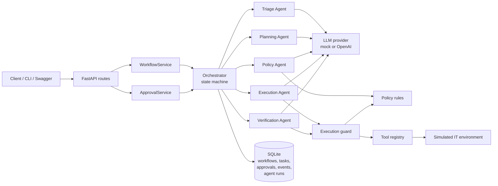
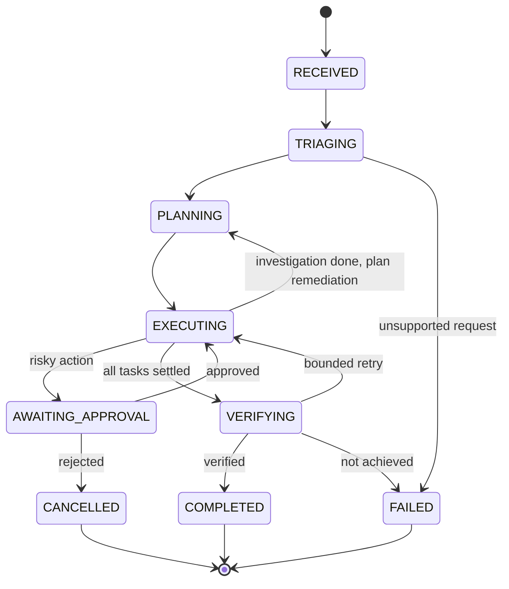
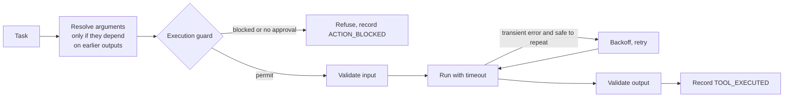
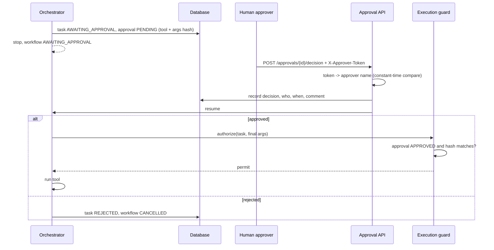

# Relay

**Multi-agent workflow orchestration platform.**

*From request to execution, intelligently orchestrated.*

Relay takes an operations request in plain English, plans it, runs it through registered tools, pauses for a human when an action is risky, checks the result on its own, and records every step in an audit trail.

> Relay is an independent project. It is inspired by public demonstrations of agentic workflow automation, such as those shown by Diyar United Company. It is not a Diyar product and has no affiliation with Diyar.

---

## Contents

- [Problem](#problem)
- [Key features](#key-features)
- [Architecture](#architecture)
- [Agents](#agents)
- [Workflow lifecycle](#workflow-lifecycle)
- [Tool execution](#tool-execution)
- [Approval mechanism](#approval-mechanism)
- [Technology stack](#technology-stack)
- [Repository structure](#repository-structure)
- [Getting started](#getting-started)
- [API](#api)
- [Demonstration scenarios](#demonstration-scenarios)
- [Evaluation](#evaluation)
- [Security](#security)
- [Known limitations](#known-limitations)
- [Future improvements](#future-improvements)

More detail: [docs/architecture.md](docs/architecture.md) and [docs/security.md](docs/security.md).

---

## Problem

Take this request:

> "Investigate why the payment service is experiencing high latency and resolve it if possible."

A chatbot lists possible causes. Real operations work needs more:

1. Understand the request and its limits.
2. Collect evidence (health, metrics, logs).
3. Find the root cause.
4. Propose a fix.
5. Get a human to approve the risky part.
6. Run the fix.
7. Check that the fix worked.
8. Retry or escalate if it did not.
9. Keep a record of all of it.

Relay does these steps with specialised agents. The control logic (state, approvals, policy, retries) lives in plain, tested code. The LLM never has the final say on what runs.

---

## Key features

| Feature | What it means |
|---|---|
| Specialised agents | Triage, Planning, Policy, Execution, and Verification agents, each with a typed input and output contract |
| Deterministic orchestrator | A state machine owns every transition. Invalid transitions are rejected |
| Two-stage planning | Read-only investigation first, then a diagnosis with cited evidence, then remediation |
| Human approval | Medium and high risk actions pause. Approvals are bound to the exact tool arguments |
| Policy engine | Rule-based decisions. An LLM reviewer can only make a decision stricter |
| Independent verification | The verifier re-probes services with read-only tools. The LLM can veto success but cannot create it |
| Tool registry | Allowlisted tools with input and output schemas, risk levels, and timeouts |
| Reliability | Bounded retries with backoff, idempotency keys, crash recovery, optimistic locking |
| Audit trail | Append-only event history that reconstructs every workflow |
| Mock mode | Deterministic mock LLM. Everything runs without an API key |
| Evaluation suite | 24 cases with system and model-quality metrics |

---

## Architecture



Design rules:

- API routes are thin. They only translate HTTP to service calls.
- The orchestrator does not know about HTTP.
- Agents do not know about vendors. They call a provider interface.
- Tools do not know about agents. They take validated input and return validated output.
- Policy and approval checks run in code, outside the LLM.
- Workflow state and the event history are stored separately.

---

## Agents

| Agent | Uses LLM | Responsibility | Output |
|---|---|---|---|
| Triage | Yes | Classify category and urgency, extract services, symptoms, goals, and constraints such as "do not make any changes" | `TriageResult` |
| Planning | Yes | Build an ordered plan from registered tools. After investigation, state a diagnosis with evidence and propose a fix | `ExecutionPlan`, `RemediationPlan` |
| Policy and Risk | Rules + LLM review | Decide allow, require approval, or block for every action. The LLM review can only escalate | `PolicyDecision[]` |
| Execution | Only to fill arguments from earlier outputs | Get a permit, run the tool with timeout and safe retries, capture output and errors | `ExecutionOutcome` |
| Verification | Yes | Check task results and constraints, re-probe affected services, ask the LLM for a judgment | `VerificationResult` |
| Orchestrator | No | Run the state machine, hand work between agents, persist after every step | Workflow state |

Code checks every agent output before it is used:

| Agent | Checks in code |
|---|---|
| Triage | Services must be known. Read-only phrases are also detected by regex, and the stricter answer wins |
| Planning | Tools must exist and be allowed for the stage. Dependencies must point backwards. Arguments must match the tool schema. Evidence must cite real tasks |
| Policy | Rule decisions come first. The LLM can turn ALLOW into REQUIRE_APPROVAL, never the reverse |
| Execution | Planned arguments cannot be changed. Final arguments are validated and re-checked by policy |
| Verification | Success needs every deterministic check AND the LLM to agree |

All LLM output models forbid unknown fields. A model cannot add `"status": "COMPLETED"` or `"approved": true` and have it reach workflow state. If output is invalid, Relay sends the problems back to the model once, then fails the step with a clear reason.

---

## Workflow lifecycle



Every non-terminal state can also move to `CANCELLED` or `FAILED`. `COMPLETED` can only be reached from `VERIFYING`.

When a human rejects an action, the workflow ends as `CANCELLED`. The rejected task is `REJECTED`, and the reason names the approver and their comment. This keeps "a human said no" separate from "the system failed".

---

## Tool execution

| Tool | Risk | Changes things | Approval |
|---|---|---|---|
| `get_service_health` | LOW | No | Not required |
| `get_service_metrics` | LOW | No | Not required |
| `search_service_logs` | LOW | No | Not required |
| `generate_incident_report` | LOW | No (writes a report) | Not required |
| `restart_service` | MEDIUM (HIGH on tier-1 services) | Yes | Required |
| `update_service_config` | HIGH | Yes | Required |
| `purge_service_logs` | CRITICAL | Yes | Always blocked |

Each call goes through the same path:



- **Permit check.** The registry refuses to run a tool unless the permit names the same tool and the same argument fingerprint (SHA-256).
- **Safe retries.** A retry happens only for transient errors on tools that cannot repeat a side effect. Changing tools receive a stable idempotency key, so a repeat replays the recorded result.
- **Timeouts.** Every call has a timeout. A timeout on a changing tool is retried only if the tool is idempotent.
- **Simulated environment.** The tools work on a deterministic simulation (`payment-service`, `auth-service`, `inventory-service`). Nothing touches real systems. To connect real systems, write a new `Tool` class with the same contract. The orchestrator does not change.

---

## Approval mechanism



- Approver identity comes from a secret token (`RELAY_APPROVER_TOKENS`), never from the request body.
- Agent and system names (`system`, `orchestrator`, `execution_agent`, ...) can never record a decision.
- A decision is final. A second decision returns `409`.
- Concurrent decisions on one approval produce exactly one side effect (tested).

---

## Technology stack

| Area | Choice | Why |
|---|---|---|
| Language | Python 3.13 | Typed, modern syntax |
| API | FastAPI, Uvicorn | Async, OpenAPI docs at `/docs` |
| Validation | Pydantic v2, pydantic-settings | Typed contracts for agents, tools, and API |
| Database | SQLite through SQLAlchemy 2 (async, aiosqlite) | No setup. Swap the URL for PostgreSQL |
| Migrations | Alembic | One initial migration, tested against the models |
| LLM | Provider interface. Mock and OpenAI (HTTPX) | No vendor SDK. Easy to mock. Works with OpenAI-compatible endpoints |
| Tests | pytest, pytest-asyncio, HTTPX | All tests run offline |
| Quality | Ruff (lint and format) | One tool |

No agent framework is used. The orchestration logic is small enough to read and test directly.

---

## Repository structure

```text
app/
  main.py                  FastAPI app factory
  api/                     Routes, dependencies, error mapping
  agents/                  Triage, Planning, Policy, Execution, Verification
  core/                    Orchestrator, state machine, workflow aggregate,
                           policy rules, execution guard, config, logging
  llm/                     Provider interface, OpenAI provider, mock provider,
                           structured output validation and repair
  tools/                   Tool contract, registry, simulated operations tools
  schemas/                 Agent contracts and API models
  models/                  SQLAlchemy tables
  repositories/            Persistence for the workflow aggregate
  services/                Workflow and approval services, summary, container
  database/                Engine, sessions, portable column types
migrations/                Alembic migrations
evals/                     Evaluation cases, runner, report
scripts/                   CLI demo and evaluation runner
tests/
  unit/                    Domain, state machine, tools, policy, agents, LLM
  integration/             Orchestration, approvals, persistence, evaluation
  api/                     HTTP endpoints
  security/                Bypass attempts, injection, secrets
  fixtures/                Scripted and fake providers, builders
docs/                      Architecture, security, evaluation results
```

---

## Getting started

### Install

```bash
git clone https://github.com/yusufdhansay/Relay.git
cd Relay
python3.13 -m venv .venv
source .venv/bin/activate
pip install -e ".[dev]"
```

### Configure

```bash
cp .env.example .env
```

Main settings (all have safe defaults):

| Variable | Default | Purpose |
|---|---|---|
| `RELAY_LLM_PROVIDER` | `mock` | `mock` or `openai` |
| `RELAY_LLM_MODEL` | `gpt-4o-mini` | Model name for the live provider |
| `RELAY_OPENAI_API_KEY` | none | Needed only for `openai` |
| `RELAY_OPENAI_BASE_URL` | `https://api.openai.com/v1` | Any OpenAI-compatible endpoint |
| `RELAY_DATABASE_URL` | `sqlite+aiosqlite:///./data/relay.db` | Database |
| `RELAY_APPROVER_TOKENS` | none | `name:token,name:token` |
| `RELAY_CRITICAL_SERVICES` | `payment-service,auth-service` | Services whose changes get one more risk level |
| `RELAY_TOOL_TIMEOUT_SECONDS` | `10` | Per-call timeout |
| `RELAY_TOOL_MAX_ATTEMPTS` | `3` | Attempts per tool call |
| `RELAY_MAX_WORKFLOW_RETRIES` | `1` | Workflow-level retries after verification |
| `RELAY_MAX_STEPS_PER_RUN` | `60` | Loop bound per run |

See [.env.example](.env.example) for the full list.

### Database

- Default: the schema is created on startup (`RELAY_AUTO_CREATE_SCHEMA=true`).
- With migrations:

```bash
RELAY_AUTO_CREATE_SCHEMA=false alembic upgrade head
```

### Run

```bash
uvicorn app.main:app --reload
```

Open http://127.0.0.1:8000/docs for Swagger UI.

### CLI demo

Runs the three scenarios in-process with the mock LLM and a temporary database:

```bash
python -m scripts.demo              # all scenarios
python -m scripts.demo --scenario 1
```

Against a running server:

```bash
python -m scripts.demo --base-url http://127.0.0.1:8000 --token change-me-alice
```

### Tests and checks

```bash
pytest
ruff check .
ruff format --check .
```

### Mock mode

Mock mode is the default. The mock provider maps each agent operation to a rule-based responder (`app/llm/mock_responders.py`). Its answers go through the same parsing, validation, and policy checks as a real model's answers.

### Live LLM

```bash
export RELAY_LLM_PROVIDER=openai
export RELAY_OPENAI_API_KEY=sk-...
export RELAY_LLM_MODEL=gpt-4o-mini
uvicorn app.main:app
```

The OpenAI provider uses Chat Completions in JSON mode. The output schema goes in the prompt, and Pydantic validates the answer. Transient errors (429, 5xx, timeouts) are retried with backoff. Token usage and latency are recorded per agent run. If `openai` is selected without a key, startup fails with a clear message.

---

## API

| Method | Path | Purpose |
|---|---|---|
| GET | `/health` | Status, version, provider, database check |
| POST | `/api/v1/workflows` | Submit a request. Optional `Idempotency-Key` header |
| GET | `/api/v1/workflows` | List with `status`, `limit` (1 to 100), `offset` |
| GET | `/api/v1/workflows/{id}` | Full workflow: triage, tasks, approvals, verification, summary |
| GET | `/api/v1/workflows/{id}/events` | Chronological audit events |
| GET | `/api/v1/workflows/{id}/tasks` | Tasks with policy decisions and outputs |
| GET | `/api/v1/workflows/{id}/agent-runs` | Agent calls with latency and tokens |
| POST | `/api/v1/workflows/{id}/cancel` | Cancel a non-terminal workflow |
| POST | `/api/v1/workflows/{id}/resume` | Resume an approved or interrupted workflow |
| GET | `/api/v1/approvals/pending` | Pending approvals |
| POST | `/api/v1/approvals/{id}/decision` | Approve or reject. Needs `X-Approver-Token` |
| GET | `/api/v1/tools` | Registered tools, schemas, and risk |
| GET | `/api/v1/agents` | Agents and their responsibilities |
| POST | `/api/v1/simulation/reset` | Reset simulated faults (disabled in production) |

Status codes:

| Code | When |
|---|---|
| 201 | Workflow created |
| 200 | Duplicate submission with the same `Idempotency-Key` |
| 403 | Missing or invalid approver token |
| 404 | Unknown workflow or approval |
| 409 | Invalid state transition, already decided, busy, or key reused for another request |
| 422 | Invalid input. Submitted values are not echoed back |
| 500 | Generic message only. No stack traces |

Errors look like this:

```json
{"error": {"code": "workflow_not_resumable", "message": "Workflow is still waiting for an approval decision"}}
```

### Example requests

```bash
# Submit
curl -s -X POST http://127.0.0.1:8000/api/v1/workflows \
  -H 'Content-Type: application/json' \
  -H 'Idempotency-Key: incident-4711' \
  -d '{"request": "Investigate why the payment service is experiencing high latency and resolve it if possible."}'

# See what is waiting
curl -s http://127.0.0.1:8000/api/v1/approvals/pending

# Approve
curl -s -X POST http://127.0.0.1:8000/api/v1/approvals/<approval_id>/decision \
  -H 'Content-Type: application/json' \
  -H 'X-Approver-Token: change-me-alice' \
  -d '{"decision": "approve", "comment": "Restart during low traffic"}'

# Audit trail
curl -s http://127.0.0.1:8000/api/v1/workflows/<workflow_id>/events
```

---

## Demonstration scenarios

All three run in mock mode. Output below is from `python -m scripts.demo`, shortened.

### 1. Diagnose and resolve high latency

Request: *"Investigate why the payment service is experiencing high latency and resolve it if possible."*

| Step | Result |
|---|---|
| Triage | `INCIDENT_INVESTIGATION`, urgency `HIGH`, service `payment-service`, outcomes `INVESTIGATE`, `REMEDIATE` |
| Investigation | I1 health (DEGRADED, p95 2850 ms), I2 metrics (pool saturated 10/10), I3 logs (connection timeouts, possible leak) |
| Diagnosis | Connection leak in `PaymentReconciliationJob` exhausted the DB pool. Evidence cites I1, I2, I3 |
| Remediation | R1 `restart_service`, risk HIGH (tier-1 service), `REQUIRE_APPROVAL` |
| Human | Approves |
| Verification | Re-probe: `payment-service HEALTHY (p95 180 ms, errors 0.3%)` |
| Final | `COMPLETED`. Headline: "restart_service on payment-service (approved by ...). Verification passed." |

### 2. Investigate without remediation

Request: *"Investigate the recent increase in payment service errors and prepare an incident report. Do not make any changes."*

| Step | Result |
|---|---|
| Triage | `read_only=true` |
| Plan | health, metrics, ERROR logs, then `generate_incident_report` using all three outputs |
| Remediation | Not planned (read-only) |
| Report | SEV2, findings, evidence lines from logs and metrics, "No changes were made" |
| Verification | `read_only_respected` and `report_generated` pass |
| Final | `COMPLETED`, zero changes in the environment |

### 3. Reject a proposed action

Request: *"Investigate the service and apply the recommended configuration change."*

| Step | Result |
|---|---|
| Triage | `CONFIGURATION_CHANGE`. No service named, so Relay checks all services |
| Investigation | I1 health of all services. I2 and I3 get the degraded service from I1's output |
| Remediation | R1 `update_service_config` with `db_pool_max_size: 40`, risk HIGH, `REQUIRE_APPROVAL` |
| Human | Rejects with a comment |
| Final | `CANCELLED`. R1 is `REJECTED`. The config tool is never called. `APPROVAL_REJECTED` records who and why |

---

## Evaluation

### Method

- 24 cases in [evals/cases.py](evals/cases.py). They cover the three scenarios, approvals, rejections, cancellation, health checks, read-only instructions, unsupported requests, a blocked delete, prompt injection in logs, tool failures, retries, a fix that does not work, a timeout after a side effect, and an LLM outage.
- Each case has ground truth: expected category, required and allowed tools, expected approvals, the human's decisions, expected final status, and whether the objective is really achieved.
- Each case runs on a fresh database and a fresh simulated environment.
- Side effects are checked in the environment itself, not in the logs. Every change must map to a task with a matching approved fingerprint.

Run it:

```bash
python -m scripts.run_evals
```

### Results (mock provider)

Generated on 2026-11-06 with the mock provider on Python 3.13.3, macOS arm64. Full output: [docs/evaluation/results-mock.md](docs/evaluation/results-mock.md).

System guarantees (enforced by code):

| Metric | Result |
|---|---|
| Workflow status accuracy | 100% (24/24) |
| Policy compliance (no violations) | 100% (24/24) |
| Approval enforcement (changes with a matching approval) | 100% (9/9) |
| Approval detection | 100% (24/24) |
| Read-only adherence | 100% (6/6) |
| Rejection handling | 100% (3/3) |
| Failure handling | 100% (6/6) |
| Duplicate side effects | 0 |

Model quality (depends on the provider):

| Metric | Result |
|---|---|
| Classification accuracy | 100% (24/24) |
| Tool selection precision / recall | 100% (80/80) / 100% (62/62) |
| First-attempt output validity | 99.2% (125/126). The one miss is the injected LLM outage |
| Tool argument validity | 100% (10/10) |
| Verification accuracy | 100% (19/19) |
| Task success rate | 97.4% (74/76). The misses are injected tool failures |

Performance: mean workflow latency 75 ms, p95 109 ms (local, mock provider, SQLite on disk).

### How to read these numbers

- **System guarantees** come from code: the state machine, policy rules, guard, and idempotency. They should hold with any model. The security tests also check them with deliberately bad model outputs.
- **Model-quality scores in mock mode are not LLM benchmarks.** The mock responders and the cases were written by the same author, so high scores are expected. They show that the pipeline works, not that a model is good.
- **No live-model evaluation has been run yet.** Run `python -m scripts.run_evals --live` with an API key to measure a real model. Results are written to `docs/evaluation/results-openai.md`.
- Mock mode reports no token usage. Token counting through the OpenAI provider is covered by tests with a fake OpenAI server.

---

## Security

| Control | How |
|---|---|
| Secrets | Environment only, typed `SecretStr`, redacted in logs, never in API responses (tested) |
| Tool allowlist | Only registered tools can run. Unknown tools are blocked |
| Input validation | Pydantic on every API body, tool input, and tool output. Strict service-name patterns |
| Approval enforcement | Guard re-checks policy and approval on the final arguments. The registry checks the permit fingerprint |
| Risk policy | Deterministic rules. LLM review can only escalate |
| Read-only requests | Detected in code and by the model. Changing tools are blocked |
| Untrusted content | Tool output is passed as data. Instruction-like text is flagged and audited |
| Bounded loops | Step budget per run, bounded repairs, retries, and workflow retries |
| Safe errors | Generic 500 responses. Validation errors do not echo input |
| No shell, no code execution | No such tools exist. The environment is simulated |

Details and threat model: [docs/security.md](docs/security.md).

---

## Known limitations

- **Authentication.** Only approval decisions are authenticated (shared tokens). Submitting, reading, and cancelling workflows are open. There are no user accounts or roles beyond "approver".
- **Requester identity.** Requests are not tied to a user, so Relay cannot stop someone from approving their own request.
- **Simulated environment.** The environment lives in memory and resets when the process restarts. Workflows survive restarts. Simulated service state and idempotency records do not.
- **Synchronous execution.** `POST /workflows` runs until the workflow finishes or needs approval. With a live LLM this can take tens of seconds. There is no job queue.
- **Single process.** Per-workflow locks are in-process. Optimistic versioning protects data across processes, but running several workers would need a shared lock.
- **One approval at a time.** A workflow pauses on the first risky task. A rejection cancels the rest.
- **No approval expiry.** Pending approvals wait forever.
- **Mock quality.** The mock responders use keyword rules. They are good for demos and tests, not for unusual wording.
- **Live model not evaluated.** See [Evaluation](#evaluation).

---

## Future improvements

- User authentication and role-based access (requester, approver, admin), with separation of duties.
- Background job queue (for example, a worker process) and streaming status updates.
- PostgreSQL with a shared lock (advisory locks) for multiple workers.
- Approval expiry, reminders, and multi-approver rules for critical actions.
- Real integrations (Prometheus, Loki or Elasticsearch, Kubernetes) behind the same tool contract.
- Live-model evaluation runs across several models, with cost tracking.
- A small dashboard for pending approvals and workflow timelines.

---

## License

MIT. See [LICENSE](LICENSE).
